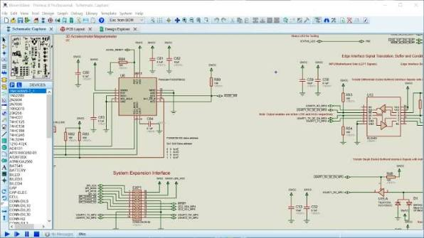
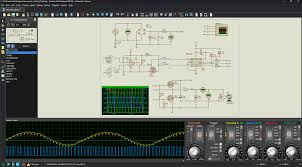

# Proteus Design Suite for Circuit and PCB Development

Proteus VSM combines circuit simulation with supported microcontroller models to explore firmware and electronics together.
Proteus Design Suite also provides schematic capture and PCB layout tools within Labcenter Electronics' design environment.

[](https://proteus-vsm.github.io/Proteus-Design-Suite/)

This independent repository collects product notes and selected AVR simulation references.
The bundled source files belong to simavr and retain their original project identity.

## About Proteus Design Suite

Proteus software supports workflows that connect a schematic, component models, and firmware.
The available processor families and board-design capabilities depend on the purchased modules and package.

| Activity | Proteus workflow | What to establish |
| --- | --- | --- |
| Draw a circuit | Schematic capture | Components, power connections, and net names |
| Explore circuit behavior | Analog, digital, and mixed-mode simulation | Models, stimuli, and measurement points |
| Exercise firmware | Proteus VSM microcontroller simulation | Processor model, program file, and clock |
| Debug an embedded design | Firmware and schematic inspection | Reproducible inputs and observable outputs |
| Develop a board | Proteus ARES PCB layout | Footprints, board outline, placement, and routing |
| Review mechanical fit | 3D PCB visualization | Component geometry and assembly orientation |
| Prepare manufacturing data | PCB output generation | Approved revision and fabrication requirements |

A firmware simulation and a board-layout review answer different questions.
A program may produce the intended output while the board still has an incorrect footprint or connector orientation.
Keep both electrical behavior and physical implementation in the review plan.

Proteus PCB design software provides a route from schematic connectivity into physical board development.
Before layout, verify the relationship between symbols, package pins, and selected footprints.



## Example

Start an embedded simulation with a small behavior that is easy to observe.
The following original AVR C example toggles PB0 on an ATmega328P.
It assumes a 16 MHz clock, supplied to the compiler through F_CPU in the next block.

```c
#include <avr/io.h>
#include <util/delay.h>
int main(void) {
    DDRB |= _BV(DDB0);
    for (;;) {
        PORTB ^= _BV(PORTB0);
        _delay_ms(250);
    }
}
```

Save the example as blink.c in a separate working folder.
In a Proteus schematic, use the matching processor model and observe PB0 with a suitable instrument or LED circuit.
PB0 is an explicit port choice here, not a reference to a board's built-in LED.

The next commands belong to the external AVR-GCC and GNU Binutils toolchain.
They compile the example and convert its program sections into Intel HEX.

```bash
avr-gcc -mmcu=atmega328p -DF_CPU=16000000UL -Os -g -o blink.elf blink.c
avr-objcopy -j .text -j .data -O ihex blink.elf blink.hex
avr-size blink.elf
```

Select the appropriate program file in the Proteus microcontroller properties and set its clock to match the build.
Labcenter documents ELF/DWARF as an AVR debugging option, while a HEX file primarily supplies executable program data.
Source-level debugging depends on the supported model, compiler output, and available debug information.

The bundled examples provide separate simavr references for basic output and interactive input:

- [atmega328p_dummy_blinky.c](examples/board_simduino/atmega328p_dummy_blinky.c) demonstrates a small AVR blinking program.
- [atmega48_ledramp.c](examples/board_ledramp/atmega48_ledramp.c) provides firmware for an LED-ramp example.
- [ledramp.c](examples/board_ledramp/ledramp.c) supplies the corresponding simulator-side board program.
- [atmega32_rotenc_test.c](examples/board_rotenc/atmega32_rotenc_test.c) demonstrates rotary-encoder input and LED output.
- [rotenc_test.c](examples/board_rotenc/rotenc_test.c) supplies its simulator-side environment.

Simulator-side board programs use simavr interfaces.
They are not firmware binaries or Proteus component models.
Some firmware examples also contain simavr metadata and require adaptation before reuse elsewhere.

## Files

Peripheral examples are useful when a small test needs to grow into a complete embedded system.
Match the controller, interface mode, pin mapping, and expected transaction sequence before comparing results.
A display with a familiar name can still require a different initialization or wiring arrangement.

The character-display references include:

- [atmega48_charlcd.c](examples/board_hd44780/atmega48_charlcd.c), firmware for an HD44780-based display example.
- [avr_hd44780.c](examples/board_hd44780/avr_hd44780.c), the display-driver implementation.
- [avr_hd44780.h](examples/board_hd44780/avr_hd44780.h), its driver declarations.
- [avr_hd44780_conf.h](examples/board_hd44780/avr_hd44780_conf.h), the associated pin configuration.

Review the configured data and control pins before adapting a display driver.
If firmware waits for a busy flag, the schematic must provide the required read connection.
Keep timing assumptions visible when replacing one interface mode with another.

For bus-oriented firmware, the collection includes:

- [atmega1280_i2ctest.c](examples/board_i2ctest/atmega1280_i2ctest.c), an I2C test application.
- [atmega328p_i2cslave.c](examples/board_i2cslave/atmega328p_i2cslave.c), an AVR I2C-slave example.
- [attiny85_i2cslave.c](examples/board_usi_i2cslave/attiny85_i2cslave.c), an ATtiny USI-based slave example.

In a Proteus test circuit, check bus pull-ups, device addressing, and the selected pin functions.
Compare the observed transaction with the peripheral's documented protocol.
Separate an addressing problem from a firmware timing or initialization problem.

Real-time-clock references provide another bus example:

- [ds1338.c](examples/board_ds1338/ds1338.c) implements a DS1338/DS1307 clock driver.
- [ds1338.h](examples/board_ds1338/ds1338.h) declares the driver interface.
- [atmega32_ds1338.c](examples/board_ds1338/atmega32_ds1338.c) demonstrates its use from AVR firmware.

The graphics-display references include:

- [ssd1306.c](examples/board_ssd1306/ssd1306.c), an SSD1306 driver using SPI.
- [atmega32_ssd1306.c](examples/board_ssd1306/atmega32_ssd1306.c), a related AVR display application.

These source files are examples for inspection, not a packaged Proteus project.
A corresponding Proteus schematic must use available device models and correctly reproduce the required connections.



## Development

A useful simulation test defines an input, an expected observation, and a condition for failure.
Record the firmware build, processor clock, schematic revision, and initial state.
Change one assumption at a time when investigating unexpected behavior.

The supplied simavr regression firmware covers several peripheral categories:

- [atmega88_uart_echo.c](tests/atmega88_uart_echo.c) exercises UART reception and interrupt handling.
- [atmega88_timer16.c](tests/atmega88_timer16.c) exercises a 16-bit timer.
- [atmega644_adc_test.c](tests/atmega644_adc_test.c) exercises analog-to-digital conversion.
- [atmega48_watchdog_test.c](tests/atmega48_watchdog_test.c) exercises watchdog behavior.
- [atmega2560_pin_change.c](tests/atmega2560_pin_change.c) exercises pin-change behavior.

Their test harness and simulator hooks belong to simavr.
Use the underlying scenarios to plan checks in Proteus rather than treating them as Proteus regression tests.

For a UART scenario, document the baud-rate assumptions and transmitted sequence.
For timer-driven behavior, compare measured intervals with the configured clock and prescaler.
For an ADC scenario, define both the reference voltage and applied signal.

Firmware output files should remain identifiable throughout the workflow.
The following Windows PowerShell example records hashes of existing ELF and HEX files in a chosen folder.

```powershell
Get-ChildItem -LiteralPath 'C:\EmbeddedReview\Firmware' -File |
    Where-Object { $_.Extension -in '.elf', '.hex' } |
    ForEach-Object {
        Get-FileHash -LiteralPath $_.FullName -Algorithm SHA256
    } |
    Select-Object Path, Algorithm, Hash
```

This is a separate filesystem inspection command, not a Proteus automation interface.
A hash helps distinguish builds but does not verify the correctness of the circuit or program.
Keep the build settings with the hash record so that the artifact can be reproduced.

Before moving from a simulated schematic into PCB layout, review:

- The exact component package and pin mapping.
- Power connections, decoupling, and reset circuitry.
- Connector orientation and signals exposed to external hardware.
- Board dimensions and mechanical restrictions.
- Routing rules and unresolved design-rule findings.
- The revision used to generate fabrication outputs.

Simulation results depend on the included models and test conditions.
Use hardware measurements to assess behavior that the selected models or stimuli do not represent.

### Requirements

Check Labcenter's requirements for the installed Proteus release and purchased modules.
A processor family supported by the product may still require a corresponding licensed simulation package.
The bundled simavr examples require their own upstream build dependencies and simulator environment.

## Documentation And Further Information

The [Proteus simulation overview](https://www.labcenter.com/simulation/) describes the circuit-simulation workflow.
The [PCB design overview](https://www.labcenter.com/pcb/) describes board-layout capabilities.
The [compiler support page](https://www.labcenter.com/compilers/) explains supported program and debug-file formats.
Use the [Labcenter resources directory](https://www.labcenter.com/resources/) for manuals, samples, and support.

For a reproducible issue report, include the processor model, clock, program-file format, and the smallest relevant schematic.
Distinguish firmware build errors from simulation-model behavior and PCB layout findings.

## License

Proteus Design Suite is proprietary software distributed under Labcenter Electronics' license terms.
The bundled simavr material retains its upstream licenses and file-specific notices.
This independent repository does not provide a Proteus license or redistribute the application.

## Related Search Terms

Proteus VSM, Proteus Design Suite, proteus software, proteus ARES PCB layout, proteus PCB design software, eda, pcb, schematic, electronics, simulation, microcontroller, embedded, avr, arduino, circuit-simulation
